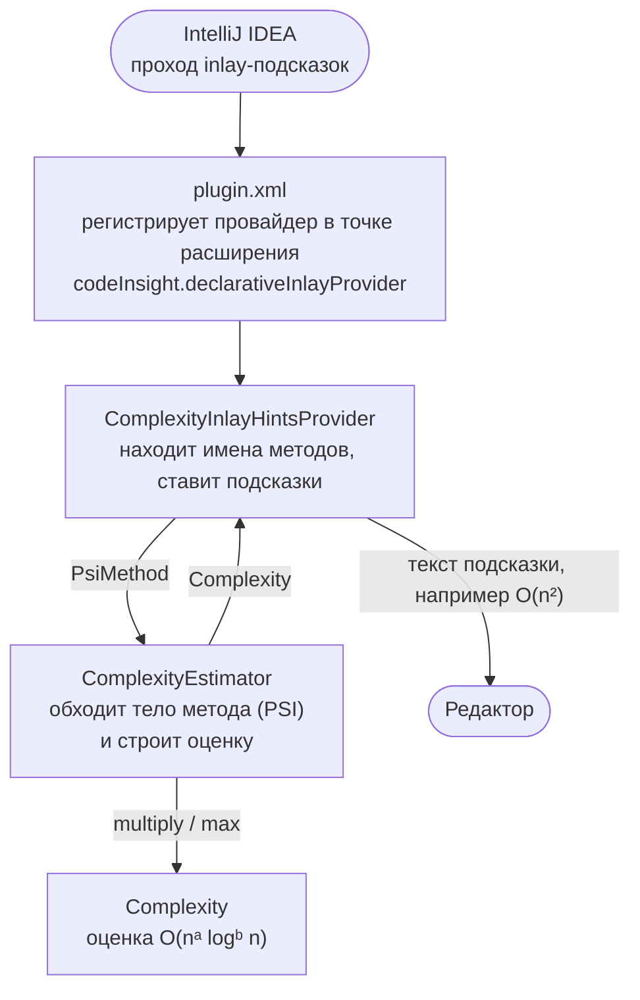
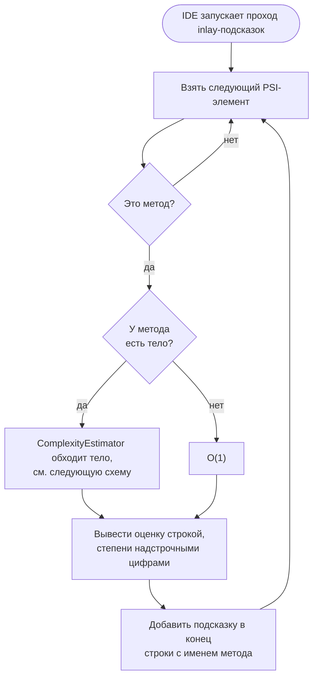
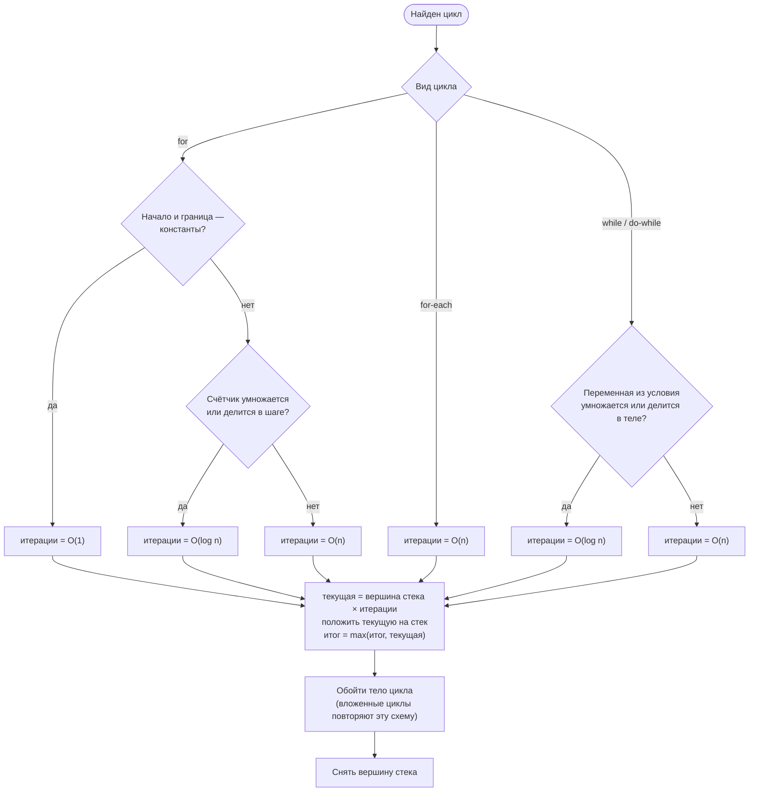

# MiniBigO

Выполнил: Ярославцев Станислав Ярославович, M3105

Плагин для IntelliJ IDEA, который оценивает временную сложность каждого Java-метода
и показывает её в нотации «O большое» в виде подсказки рядом с именем метода.

```java
int sumOfPowers(int[] arr) {                      O(n log n)
    int sum = 0;
    for (int x : arr)
        for (int p = 1; p <= x; p *= 2)
            sum += p;
    for (int i = 0; i < arr.length; i++)
        sum++;
    return sum;
}
```

- [Техническое задание](#техническое-задание)
- [Архитектура](#архитектура)
- [Сборка](#сборка)

## Техническое задание

**Цель.** Быстро и приблизительно показать, насколько дорог метод, прямо в редакторе,
без запуска и отладки кода.

### Требования

1. Для каждого Java-метода с телом показывать подсказку в конце строки с именем метода, например `O(n log n)`.
2. Оценивать сложность статически, по вложенности циклов. Поддерживаемые циклы: `for`, `for-each`, `while`, `do-while`.
3. Считать, что все циклы проходят по одному и тому же размеру входных данных `n`.
4. Вложенные циклы перемножаются: два вложенных цикла дают `O(n²)`. Из последовательных циклов берётся самый тяжёлый: `O(n)` и `O(n²)` подряд дают `O(n²)`.
5. Распознавать логарифмические циклы, в которых счётчик умножается или делится (`*=`, `/=`, `x = x * c`, `x = x / c`): `O(log n)`.
6. Считать цикл `for` с границами-константами времени компиляции (`for (int i = 0; i < 10; i++)`) за `O(1)`.
7. Выводить степени надстрочными цифрами: `O(n² log n)`, `O(n log² n)`.

### Out of scope

Плагин намеренно не учитывает:

- разные размеры входных данных: `O(n·m)` будет показано как `O(n²)`;
- рекурсию и вызовы других методов, в том числе библиотечных вроде `list.contains(x)`: каждый вызов считается за `O(1)`;
- стримы, а также код внутри лямбд, анонимных и локальных классов;
- досрочный выход (`break`, `return`), поэтому оценка ближе к верхней границе;
- сложность по памяти;
- языки, кроме Java.

## Архитектура

### Компоненты

Плагин состоит из трёх классов. Каждый зависит только от тех, что ниже на схеме.



| Компонент | Назначение |
|---|---|
| `plugin.xml` | Описывает плагин, его зависимость от Java-плагина и провайдер inlay-подсказок для `JAVA`. |
| `ComplexityInlayHintsProvider` | Точка входа, которую вызывает IDE. Перебирает PSI-элементы файла, выбирает методы, запрашивает у анализатора сложность и добавляет подсказку в конец строки с именем метода. |
| `ComplexityEstimator` | Анализ. `JavaRecursiveElementVisitor`, который обходит тело метода, определяет, сколько раз выполняется каждый цикл, и объединяет результаты. |
| `Complexity` | Неизменяемая оценка `O(nᵃ logᵇ n)`: record из двух чисел — степени `n` и степени `log n`. Умеет умножаться (`multiply`), выбирать большую из двух (`max`) и выводиться строкой. |

### Принцип работы

Что происходит с каждым элементом открытого Java-файла:



`ComplexityEstimator` хранит стек оценок. Вершина стека показывает, сколько раз выполняется код,
который обходится в данный момент. Изначально в стеке лежит `O(1)`, итог тоже `O(1)`. Для каждого цикла анализатор делает следующее:



Лямбды, анонимные и локальные классы пропускаются: их код выполняется не на месте.

Пример из начала страницы по шагам:

| Цикл | Итерации | Вершина стека | Итог |
|---|---|---|---|
| (тело метода) | | `1` | `1` |
| `for (int x : arr)` | `n` | `n` | `n` |
| `for (p = 1; p <= x; p *= 2)`, вложенный | `log n` | `n log n` | `n log n` |
| `for (i < arr.length)`, после первого | `n` | `n` | `n log n` |

Подсказка показывает `O(n log n)`.

## Сборка

| Команда | Что делает |
|---|---|
| `./gradlew runIde` | Запускает изолированную IntelliJ IDEA с установленным плагином. |
| `./gradlew buildPlugin` | Собирает архив плагина в `build/distributions/`. |
| `./gradlew javadoc` | Собирает документацию API в `build/docs/javadoc/`. |
